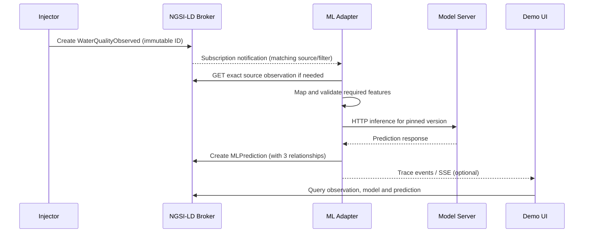

# Architecture (design v0.1)

## Goal and boundaries

Demonstrate how **standard NGSI-LD subscriptions** trigger inference on a **deployed conventional ML model**, with the result returned as a **new context entity** referencing the exact immutable input observation. The broker must not perform ML logic.

## Components

| Component | Responsibility | Initial implementation |
|---|---|---|
| NGSI-LD Context Broker | CRUD, contextual selection, notifications, persistence | Evaluate **coraine** first; fallback Orion-LD only if smoke tests fail |
| Offline ML scripts | Download/split, train, validate, evaluate, save artifact | scikit-learn, optional MLflow Tracking |
| Local model serving | HTTP inference from a **specific artifact/version** | MLflow Models serving (`/invocations`) |
| ML Adapter | Translate notification -> fetch observation -> map -> infer -> publish; maintain subscription tied to MLProcessing | Minimal FastAPI application |
| Injector | Replay reserved data as NGSI-LD entities | Script or minimal UI action |
| Demo UI | Show models, processings, observations, notifications, outputs and trace | Minimal web app; no training UI needed |

## Three explicitly separated phases

### Phase A — Train and prepare (offline, manual/script)

Obtain Water Potability dataset; preserve origin/license/checksum; reserve demo records before fitting; stratified split train/validation/test; impute using training-only statistics; train estimator; inspect metrics; save immutable model artifact and metadata. **No automatic training triggered by Context Broker input.**

### Phase B — Deploy and register (explicit, manual/script)

1. Launch serving for a **particular** model artifact/version and check HTTP health/inference contract.
2. Create `MLModel` in the broker, containing description, model identity, version, input/output schemas and network-reachable serving address.
3. Create `MLProcessing`, linking to `MLModel`, and providing source entity type, watched attributes, optional `q` (or later `geoQ`) and feature mapping.
4. Adapter validates configuration and creates a **standard NGSI-LD Subscription** pointing to itself; records subscription ID on `MLProcessing` (once actual API behavior validated).

Registering an `MLModel` is **not** an instruction to launch a model container. A serving endpoint must already exist and pass a smoke test.

### Phase C — Runtime (event-driven, automatic)

## Design decisions

- **Exactly one immutable observation per prediction** in v1. The source entity is never overwritten by the injector.
- **One pinned model version per MLProcessing**. No model hot-swapping or version comparison in v1.
- `watchedAttributes` controls notification-triggering changes; model `inputAttributes`/`inputMapping` control features sent to inference. These are not interchangeable.
- For demonstrator thresholds, `q` selects entities matching a **current-state condition**; it is not intrinsically an edge-detection rule ('crossed threshold').
- `MLPrediction` is a **new** generic proposed entity, not a claim of official standardization.
- Operational logs/errors need not become NGSI-LD entities. Trace IDs link log events to the resulting `MLPrediction`.
- No recursive inference: subscriptions watch only input types, not `MLPrediction`.
- Standard broker subscriptions are **API resources**, not application entities created at `/entities`.

## Unverified implementation dependencies (mandatory smoke tests)

- Exact support of `watchedAttributes`, `q`, subscription notifications, and persistent restart in selected coraine version.
- Semantics for notifications on entity creation; select a reliable trigger strategy and document actual behavior.
- Network reachability of model URI **inside containers** (do not use browser `localhost` for service-to-service calls).
- Correct NGSI-LD JSON-LD contexts, property names, official schemas, and data-unit semantics.
- Deterministic handling of retried notifications (idempotent prediction ID plus conflict behavior).
