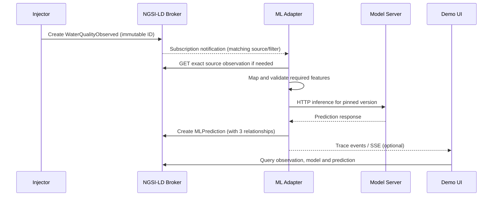

# Architecture (design v0.1)

## Goal and boundaries

Demonstrate how **standard NGSI-LD subscriptions** trigger inference on a **deployed conventional ML model**, with the result returned as a **new context entity** referencing the exact immutable input observation. The broker must not perform ML logic.

## Components

| Component | Responsibility | Initial implementation |
|---|---|---|
| NGSI-LD Context Broker | CRUD, contextual selection, notifications, persistence | Evaluate **coraine** first; fallback Orion-LD only if smoke tests fail |
| Offline ML scripts | Download/split, train, validate, evaluate, save artifact | scikit-learn, optional MLflow Tracking |
| Local model serving | HTTP inference from a **specific artifact/version** | MLflow Models serving (`/invocations`) |
| ML Adapter | Translate notification -> fetch observation -> map -> infer -> publish; maintain subscription tied to MLProcessing | Minimal FastAPI application |
| Injector | Replay reserved data as NGSI-LD entities | Script or minimal UI action |
| Demo UI | Show models, processings, observations, notifications, outputs and trace | Minimal web app; no training UI needed |

## Three explicitly separated phases

### Phase A — Train and prepare (offline, manual/script)

Obtain Water Potability dataset; preserve origin/license/checksum; reserve demo records before fitting; stratified split train/validation/test; impute using training-only statistics; train estimator; inspect metrics; save immutable model artifact and metadata. **No automatic training triggered by Context Broker input.**

### Phase B — Deploy and register (explicit, manual/script)

1. Launch serving for a **particular** model artifact/version and check HTTP health/inference contract.
2. Create `MLModel` in the broker, containing description, model identity, version, input/output schemas and network-reachable serving address.
3. Create `MLProcessing`, linking to `MLModel`, and providing source entity type, watched attributes, optional `q` (or later `geoQ`) and feature mapping.
4. Adapter validates configuration and creates a **standard NGSI-LD Subscription** pointing to itself; records subscription ID on `MLProcessing` (once actual API behavior validated).

Registering an `MLModel` is **not** an instruction to launch a model container. A serving endpoint must already exist and pass a smoke test.

### Phase C — Runtime (event-driven, automatic)

## Design decisions

- **Exactly one immutable observation per prediction** in v1. The source entity is never overwritten by the injector.
- **One pinned model version per MLProcessing**. No model hot-swapping or version comparison in v1.
- `watchedAttributes` controls notification-triggering changes; model `inputAttributes`/`inputMapping` control features sent to inference. These are not interchangeable.
- For demonstrator thresholds, `q` selects entities matching a **current-state condition**; it is not intrinsically an edge-detection rule ('crossed threshold').
- `MLPrediction` is a **new** generic proposed entity, not a claim of official standardization.
- Operational logs/errors need not become NGSI-LD entities. Trace IDs link log events to the resulting `MLPrediction`.
- No recursive inference: subscriptions watch only input types, not `MLPrediction`.
- Standard broker subscriptions are **API resources**, not application entities created at `/entities`.

## Integration checklist (mandatory smoke tests)

Results are recorded in [implementation verification](implementation.md).

- Exact support of `watchedAttributes`, `q`, subscription notifications, and persistent restart in selected coraine version.
- Semantics for notifications on entity creation; select a reliable trigger strategy and document actual behavior.
- Network reachability of model URI **inside containers** (do not use browser `localhost` for service-to-service calls).
- Correct NGSI-LD JSON-LD contexts, property names, official schemas, and data-unit semantics.
- Deterministic handling of retried notifications (idempotent prediction ID plus conflict behavior).

## Verified implementation decisions

Coraine `0.6.1-post-2026-11-03-7299e496` passes the direct API smoke tests with
corDB persistence. Matching entity creation triggers a notification; changes to
unwatched properties do not. The implementation uses creation-only replay.
No alternate application trigger is needed.

FastAPI hosts both the generic adapter and a static dashboard. The dashboard polls
`/state` and `/events` every second. `mlaas/demo.py` contains only the water-specific
replay endpoint; it never invokes a model. The broker remains responsible for q.

An explicit processing registration command calls `/processings/reconcile`.
That operation validates and pins model/processing configuration, uses a stable
standard subscription ID and records `refSubscription`. Pausing and reconciling
deletes the subscription. Requests already accepted into the local job journal
drain. Changed bindings require new processing IDs.

Notifications are committed to a small SQLite job journal before acknowledgment.
One worker fetches sources, validates/maps numeric features, invokes MLflow and
publishes predictions. This is local process state, not a new context entity or
an orchestration service. Transport/server failures retry with capped backoff;
invalid input fails visibly. Jobs and trace events survive adapter restarts.
There is one adapter process and one inference worker in v1.

The serving command checks the pinned artifact's version and SHA256, then starts
standard MLflow Models serving. The Compose service serves v1 explicitly, with
artifacts mounted read-only. New model versions need separate serving endpoints;
never silently replace the artifact behind an existing endpoint.

Source immutability is an application contract, not a broker access-control rule.
The injector only creates new IDs. The worker stores a source fingerprint and
checks it on retries and before publication. A deployment with untrusted writers
would need broker authorization outside this local v1 scope.

See [verification and limitations](implementation.md), including JSON-LD
compaction and numeric serialization behavior observed in the selected broker.

## Inspector and owned demo reset

`GET /inspect/entities?id=...` and `GET /inspect/subscriptions?id=...` proxy an
exact broker resource without substituting example payloads or normalized state.
The dashboard side panel displays properties, relationships and raw JSON-LD.
Its flow navigation moves between existing sections; no new service is added.

Replay is now ownership-aware. Both UI and CLI use `POST /inject`. SQLite stores
a persistent owner token, stable per-sample IDs, expected source payloads, replay
position and counters. A source is reserved before broker POST so an ambiguous
network response remains recoverable. The `demoOwner` Property is a project
extension on owned observations and adapter outputs, not a new entity type.
A marker alone does not authorize deletion: a local ownership record is required.

`POST /demo/reset` requires `confirm:true`, persists a reset gate and advances the
replay generation before starting a local background thread. It waits on the
same process lock used for one inference job, notification acceptance and each
replay creation. The active HTTP invocation may finish; its prediction is then
removed. The old replay generation cannot resume even if reset finishes before
the replay HTTP request unwinds. New demo work is blocked while reset is running
or failed. Unrelated sources retain their jobs and notifications.

For each tracked source, reset checks ownership and pinned lineage of journaled
predictions, deletes those predictions, then checks and deletes the source. Each
deletion is followed by GET verification (404 required). Only after the complete
source group is absent does one SQLite transaction remove its dedup jobs and
associated trace and mark the source inactive. Mixed notification trace records
retain unrelated source entries. Unjournaled outputs are preserved even if they
reference a demo source. There is no type-wide broker scan or bulk deletion.

Partial success is committed per source. Failures retain that source's jobs,
trace and ownership, with replay blocked. A confirmed retry tolerates 404s for
already deleted entities. Restart changes an interrupted reset to failed and
keeps the gate closed until retry. Inactive ownership records are retained as
tombstones to ignore late notifications; replay reactivates them using the same
IDs. Successful reset zeros position and counters and preserves configuration
pins, subscriptions, deployment and artifacts.

This coordination assumes one adapter process, as configured in Compose. It does
not protect against arbitrary concurrent broker writers ignoring the immutable
source contract. Lost ownership journals and pre-upgrade replay entities cannot
be reconstructed safely and are never adopted for deletion.
