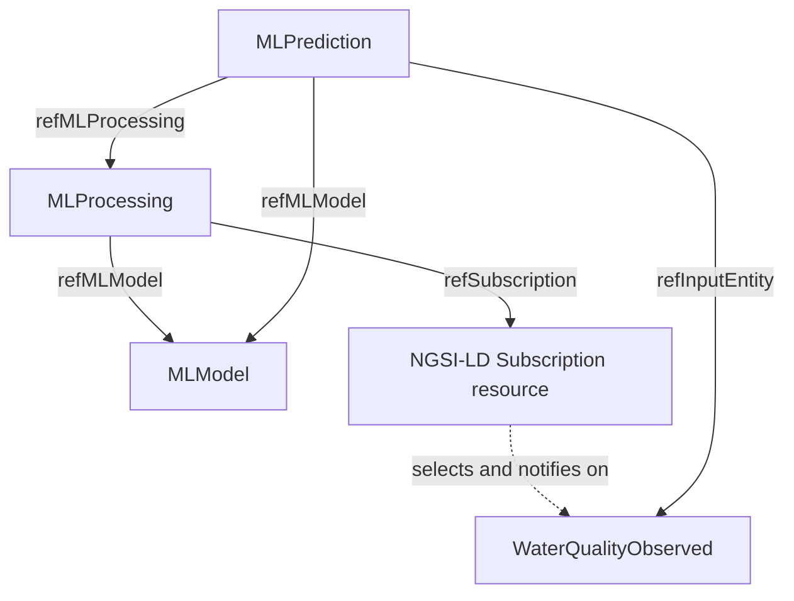

# Information model (proposal v0.1)

This document is the normative **project proposal**, not a statement that every attribute listed is part of an official Smart Data Model. Validate individual official schemas before finalizing JSON-LD contexts.

## Resource inventory

| Resource | Kind | Purpose |
|---|---|---|
| `MLModel` | NGSI-LD Entity; based on existing ML Smart Data Model | Describe a **specific** trained/deployed model version |
| `MLProcessing` | NGSI-LD Entity; based on existing ML Smart Data Model | Declare **which model**, **which source data**, **under which conditions**, **which output** |
| `WaterQualityObserved` | NGSI-LD Entity; adapt existing Water Quality SDM | One immutable water sample, with nine measured attributes |
| `MLPrediction` | **Project-defined** NGSI-LD Entity | One inference output with explicit provenance |
| `Subscription` | Standard NGSI-LD **subscription API resource** | Broker filtering and callback delivery; managed from processing config |

No `MLExecution`, `MLDataset`, `MLTrainingRun`, or separate `SubscriptionQuery` entity is needed for v1. MLflow holds experiment metadata; adapter logs hold transient execution trace. `subscriptionData` is embedded in `MLProcessing`.

## 1. MLModel

Existing source proposal: `name`, `description`, `dockerImage`, `algorithm`, `mlFramework`, `version`, `inputAttributes`, `acceptableDataTypes`, `outputAttributes`, `outputDataTypes`. We retain their intent and simplify serving metadata.

| Attribute | NGSI-LD representation | Required? | Meaning |
|---|---|---|---|
| `name` | Property/string | Yes | Human-readable name |
| `description` | Property/string | Yes | Human- and agent-readable description and intended use |
| `algorithm` | Property/string | Yes | e.g. `RandomForestClassifier` |
| `mlFramework` | Property/string | Yes | e.g. `scikit-learn` |
| `version` | Property/string | Yes | Exact immutable model version |
| `inputAttributes` | Property/array of strings | Yes | Ordered features required by model |
| `acceptableDataTypes` | Property/array | Yes | Input entity types (e.g. `WaterQualityObserved`) |
| `outputAttributes` | Property/array | Yes | Meaningful output names, e.g. `predictedValue` |
| `outputDataTypes` | Property/array | Yes | Output value types/semantics |
| `servingEndpoint` | Property/string URI | Yes | HTTP endpoint reachable from adapter |
| `artifactURI` | Property/string | Yes | Local path or MLflow model URI |
| `dockerImage` | Property/string | No | Container image when model is containerized |
| `trainingRunId` | Property/string | No | MLflow run link if tracked |
| `evaluationMetrics` | Property/object | No | A compact metric summary |

**Invariant:** `urn:ngsi-ld:MLModel:WaterPotability:v1` always means the same model artifact and version. New version => new entity. `MLModel` is metadata, not the artifact itself.

## 2. MLProcessing

Based on PDF `refMLModel` and `subscriptionData`; output destination changes from writing on input entity to a **new `MLPrediction`**.

| Attribute | NGSI-LD representation | Required? | Meaning |
|---|---|---|---|
| `name` | Property/string | Yes | Description in UI |
| `refMLModel` | Relationship/object | Yes | Exact `MLModel` entity ID |
| `subscriptionData` | Property/object | Yes | `entities`, `watchedAttributes`, optional `q`; reserve `geoQ` for extension |
| `inputMapping` | Property/object | Yes | Feature name -> source property name |
| `outputEntityType` | Property/string | Yes | `MLPrediction` in v1 |
| `processingStatus` | Property/string | Yes | `active` / `paused` / `error` |
| `refSubscription` | Relationship/object | No | Broker subscription ID once created |
| `description` | Property/string | No | Human- and agent-readable objective |

**Invariant:** one `MLProcessing` refers to one **pinned** `MLModel`. Its subscription selects observations, not models. The adapter creates/reconciles/deletes actual subscriptions; simple manual scripts may create the processing.

### `subscriptionData` is not a subscription entity

Example configuration:

```json
{
  "entities": [{"type": "WaterQualityObserved"}],
  "watchedAttributes": ["turbidity"],
  "q": "turbidity>4"
}
```

`q` is a filter on the **entity's state** at notification time; it is not a promise of threshold *crossing detection*. The full feature set can be fetched by the adapter despite only one watched attribute.

## 3. WaterQualityObserved

**One immutable entity per dataset sample.** Proposed canonical ID: `urn:ngsi-ld:WaterQualityObserved:Sample:0042`. Preserve the originally recorded sample values; simulated injection time is not historical measurement time.

| Attribute | Corresponding CSV column | Type | Required? |
|---|---|---|---|
| `ph` | `ph` | numeric Property | Yes (value may be null only when explicitly supported) |
| `hardness` | `Hardness` | numeric Property | Yes |
| `solids` | `Solids` | numeric Property | Yes |
| `chloramines` | `Chloramines` | numeric Property | Yes |
| `sulfate` | `Sulfate` | numeric Property | Yes |
| `conductivity` | `Conductivity` | numeric Property | Yes |
| `organicCarbon` | `Organic_carbon` | numeric Property | Yes |
| `trihalomethanes` | `Trihalomethanes` | numeric Property | Yes |
| `turbidity` | `Turbidity` | numeric Property | Yes |
| `sampleId` | source row identity | string Property | Yes |
| `sourceDataset` | provenance | string Property | Yes |

**Important:** the input dataset has missing values. Define an interoperable null/missing-attribute policy before implementation; the ML preprocessing pipeline owns imputation. The sample `Potability` label is **not** published as an input property. The official `WaterQualityObserved` model may use **different property names** or represent different semantics; map and document every project extension after checking its schema. Do not assume units when the dataset does not explicitly justify them. `observedAt` belongs on each measurement Property where meaningful; do not fabricate a historical acquisition time from playback time.

## 4. MLPrediction

New proposed generic ML outcome entity; **not** `WaterQualityPredicted` and not an official standard claim.

| Attribute | NGSI-LD representation | Required? | Meaning |
|---|---|---|---|
| `refInputEntity` | Relationship | Yes | Exact immutable input sample |
| `refMLModel` | Relationship | Yes | Concrete version used |
| `refMLProcessing` | Relationship | Yes | Processing rule that caused inference |
| `predictedValue` | Property/number or string | Yes | Model output |
| `predictionType` | Property/string | Yes | e.g. `classification` |
| `predictionScore` | Property/number | No | Confidence/probability if meaningful |
| `scoreMeaning` | Property/string | Conditional | e.g. `probability_of_class_1` |
| `predictedAt` | Property/ISO 8601 string | Yes | Inference completion time |
| `executionId` | Property/string | Yes | Link to backend trace |

**Invariant:** prediction ID is stable for a given `(processing ID, model version, source observation ID)`; repeated notifications do not create duplicate prediction entities. No replication of the source's feature values in the prediction.

## Relationships



## NGSI-LD context and examples

See `examples/`. Examples use a **project-owned example namespace** for custom terms and have only been JSON syntax checked. Prior to runtime, map official Smart Data Model fields to their official terms and verify with an actual broker. The examples should not be mistaken for official Smart Data Model-compliant payloads until verified.

## Source references and deliberate differences

- *Fluid Machine Learning lifecycle with FIWARE*, p. 5: core `MLModel` metadata.
- *ML as a Service – Specifications*, pp. 5–8: `MLProcessing` drives a subscription; source inputs are transformed into model features; original proposal writes output attributes on the source entity.
- **Deliberate deviation:** we instead emit standalone `MLPrediction` with three explicit Relationships, keeping source immutable and lineage direct.
- *ML as a Service – Specifications*, pp. 9–10: `MLProcessing`, `MLModel`, `subscriptionData` and future need for multiple inputs/windowing. Those enhancements are out of scope for the template MVP.
